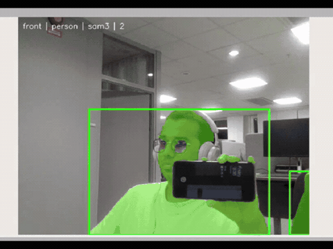
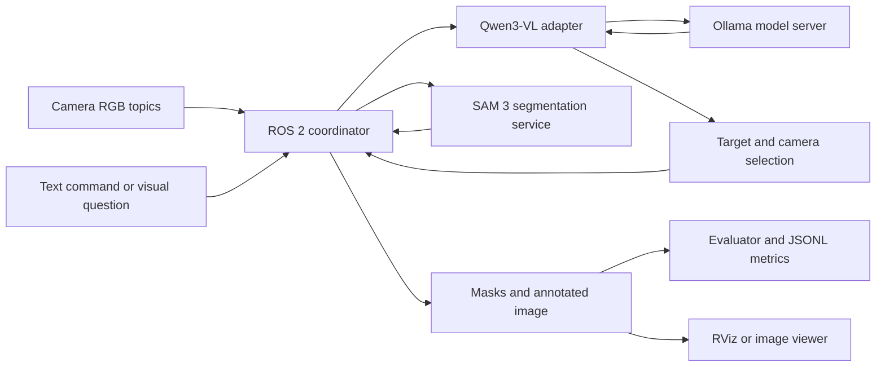

# ScenePilot · Language-Guided Robot Perception

**ROS 2 Jazzy · Qwen3-VL · SAM 3 · Docker Compose · Python**

ScenePilot connects natural-language commands to camera-based perception. Ask a visual question, select a target such as a person or phone, and view segmentation masks and bounding boxes on a ROS image stream.

A vision-language model interprets the request and selects a target and camera. A separate SAM 3 backend segments that target across incoming frames. ROS coordination, model serving and evaluation run as separate container services.

**Status:** working VLM and segmentation demos; the wider platform is under active development.

[](docs/demos/tracking-highlights.mp4)

*Recorded on the Jazzy container setup. The preview combines four target examples; [watch the 80-second highlight](docs/demos/tracking-highlights.mp4) or [download the MP4](https://github.com/ADHU-ADHU/scenepilot-ros2/raw/refs/heads/main/docs/demos/tracking-highlights.mp4).*

[Setup and demo commands](docs/SETUP.md) · [Architecture](docs/ARCHITECTURE.md) · [Validation and project status](docs/STATUS.md) · [Evaluation](docs/EVALUATION.md)

## Recorded demos

| Demo | What it shows | Video |
| --- | --- | --- |
| RViz2: target tracking | Person → phone → headphones → glasses, with masks and bounding boxes | [80 s · MP4](docs/demos/tracking-highlights.mp4) |
| Terminal: commands and replies | Smartphone question/answer and the phone-tracking confirmation | [68 s · MP4](docs/demos/terminal-interaction.mp4) |
| Combined: visual question answering | Terminal interaction alongside the camera/segmentation view | [68 s · MP4](docs/demos/visual-question-answering.mp4) |

These are edited excerpts from the supplied screen recordings, played at their original timing. They demonstrate the workflow rather than measure accuracy or inference speed. [Media details and full-resolution poster](docs/demos/README.md).

## How it works



The VLM handles the question or target-selection step; it is not called for every segmentation frame. The coordinator keeps the latest images, schedules backend work, and discards responses belonging to superseded commands. In the default single-GPU configuration, models unload before another model uses the GPU, so a new visual query can pause segmentation while models reload.

“Tracking” here means repeated text-prompted segmentation and visual overlays. Persistent instance IDs, reidentification and robot motion control are future work.

## Current capabilities

- Natural-language target selection and visual question answering through Qwen3-VL.
- SAM 3 masks and bounding boxes, with source image timestamps and camera identity preserved.
- Configurable front/rear camera inputs and atomic target/camera selection.
- Runtime backend selection, stale-response protection, bounded work queues and serial GPU scheduling.
- Separate evaluation node, JSONL results, recorded-input tools and CPU test backends.

Optional speech input, registered depth/3D estimates and model-comparison interfaces are included in the source. Their implementation and validation status are distinguished in the [status document](docs/STATUS.md). No completed autonomous navigation system or accuracy benchmark is claimed.

## Container layout

| Service | Responsibility |
| --- | --- |
| `system` | ROS coordinator, camera buffers, commands, target state and annotated output |
| `vlm4` | API adapter for `qwen3-vl:4b-instruct-q4_K_M`, the demonstrated default |
| `vlm2` | Alternative adapter for `qwen3-vl:2b-instruct-q4_K_M`; download its model before selecting it |
| `ollama` | Loads and runs the selected Qwen model |
| `sam` | Runs SAM 3 text-prompted image segmentation |
| `evaluator` | Observes results and writes per-backend metrics |

Optional `single-camera`, `cameras` and `speech` profiles supply local camera and microphone inputs. The two VLM adapter names refer to **model size**, not different Qwen generations. Both adapters may be running while the coordinator uses only the selected backend.

## Get started

The learned-model demo targets a Linux NVIDIA GPU host with Docker Compose and NVIDIA Container Toolkit. Model weights are supplied separately.

```bash
git clone https://github.com/ADHU-ADHU/scenepilot-ros2.git
cd scenepilot-ros2
cp .env.example .env
mkdir -p models data artifacts
# Set SAM_CHECKPOINT in .env to an existing SAM 3 checkpoint.
docker compose config --quiet
docker compose build
docker compose up -d ollama
docker compose exec ollama ollama pull qwen3-vl:4b-instruct-q4_K_M
docker compose up -d
```

With camera images available, open the text interface:

```bash
bash scripts/ros_exec.sh ros2 run scene_user text_interface
```

Example requests:

```text
Track the person in the front camera.
What is the person holding?
Track the phone in the front camera.
Stop tracking.
```

Display `/tracking/image` in RViz with **Best Effort** image reliability. The [setup guide](docs/SETUP.md) covers one-camera operation, model readiness, ROS settings, switching and troubleshooting.

## Test without model weights

```bash
python3 -m venv .venv
source .venv/bin/activate
python -m pip install -r docker/requirements-api.txt pytest
python -m pytest -q tests
```

For the ROS/HTTP synthetic workflow in a CPU container:

```bash
docker compose -f compose.mock.yaml build
docker compose -f compose.mock.yaml run --rm smoke
```

The mock workflow exercises ROS messages, services, backend switching, recovery and optional depth using deterministic fixtures. It is separate from learned-model validation. Fresh publication checks and their limits are recorded in [docs/STATUS.md](docs/STATUS.md).

## Repository layout

```text
src/perception_core/         Backend API, adapters, contracts and GPU scheduling
src/perception_ros/          Coordinator, evaluator, synthetic camera and launches
src/perception_interfaces/   Selection, result and backend-control interfaces
src/scene_camera/            V4L2 camera publisher
src/scene_user/              Text interface and optional assistant panel
src/scene_speech/            Optional Whisper speech input
src/scene_interfaces/        Command message
config/                     Cameras, models, prompts and CPU test settings
docker/                     ROS, API and SAM image recipes
scripts/                    Readiness, ROS smoke and recorded-input tools
docs/                       Setup, architecture, status, evaluation and demos
vendor/                     Pinned SAM 3 source snapshot and its license
```

Near-term work includes persistent tracking identities, physical depth-camera validation, repeatable labelled evaluation and an automatic backend-selection policy. The existing switching and measurement interfaces provide the integration points.

Developed by **[Adhithya Palanisamy Chandrasekaran](https://github.com/ADHU-ADHU)**. Built with [ROS 2](https://docs.ros.org/en/jazzy/), [Qwen3-VL through Ollama](https://ollama.com/library/qwen3-vl), and [Meta SAM 3](https://github.com/facebookresearch/sam3). See [third-party notices](THIRD_PARTY_NOTICES.md); checkpoints and runtime data are not included.
