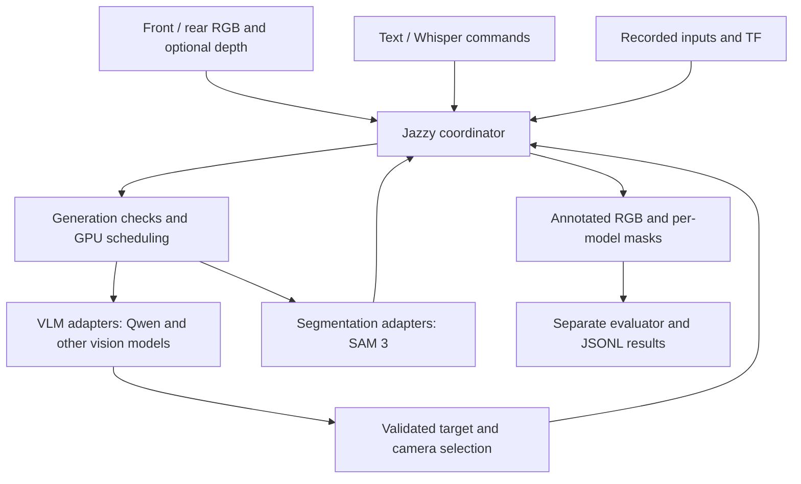

# ScenePilot architecture

The `system` container owns ROS subscriptions, latest-frame buffers, command routing, atomic selections, annotation, and the single-writer resource scheduler. `evaluator` runs a separate Jazzy node. Optional `cameras` and `speech` services preserve the original camera and Whisper code. The legacy text interface and assistant panel remain installable. No model runtime is imported into the ROS coordinator.

`vlm4` and `vlm2` are independently restartable API adapters; they use one local Ollama engine by default. They have independent prompts, model tags, and inference settings, but share the engine's lifecycle and cache. Deploy additional Ollama engines with separate endpoints, ports and GPU assignments when engine failure isolation or simultaneous resident VLMs is needed. `sam` has its own Python/CUDA environment and model lifecycle.

Every backend implements `GET /healthz`, `GET /readyz`, `POST /infer` and `POST /unload`. Health checks distinguish a live HTTP service from a ready model: `/readyz` validates Ollama vision capability or the SAM checkpoint and CUDA access. A running process is not proof the model can infer. The SAM Docker build includes an import check; `/infer` exercises actual loading.

The default JSON API is for trusted internal networks. Loopback listeners and Linux host networking keep model APIs local in the default deployment. Remote deployments need their own networking and access-control configuration. Keep these internal listeners on loopback in the default local setup.

## Request identity and switching

Requests carry API version, request ID, generation, camera identity and original image header. Responses must echo identity exactly. The coordinator alone commits control results in a single ROS executor. A new query, manual selection, stop or backend switch increments the generation. Late results cannot change the target, annotated output or short conversation history. Queued requests are checked again after acquiring a GPU lease. Switching chooses a route immediately, while readiness is tested when inference starts; a missing model generates an explicit error, not a silent fallback.

The latest pending query replaces older pending queries. Each backend has at most one outstanding request. Image buffers retain the newest frame; skipped frames are not queued without limit. Segmentation scheduling pauses during active VLM selection so a segmentation request for the previous target cannot share the new target's generation. Comparison VLM results are published for inspection but never control the active target.

`/perception/select_target` applies camera and target atomically. `/sam/target` and `/sam/camera` retain their names, `std_msgs/String` types and VLM-to-tracker notification meaning. They are compatibility outputs in this platform; direct manual publishers must use the atomic service or `/perception/input/target` and `/perception/input/camera`. This explicit input/output separation avoids echo loops and the cross-topic ordering race in the original design. Jazzy's installed Python `MessageInfo` does not provide publisher GID filtering. Existing downstream consumers of `/sam/*` continue to work. The original `/vision/command` custom message remains accepted (uses the currently selected camera, since it has no camera field).

## Resource groups

All three local adapters belong to `laptop_gpu` in `serial` mode. On first use, including after a coordinator restart, the scheduler obtains unload acknowledgements from every configured member. On a model change it unloads the previous resident before admitting the next. All configured members of a serial group must therefore be running. SAM loads lazily and stays resident between frames; switching to a VLM unloads SAM, and switching back unloads that VLM. This protects GPU capacity at the cost of model reload latency and a tracking pause during queries.

An HTTP timeout is not cancellation. The previous server keeps its inference lock until work finishes; unload returns busy while work remains. The scheduler retains an uncertain lease and requires an unload acknowledgement before proceeding. External model servers must implement equivalent unload semantics. Do not bypass the coordinator with direct inference calls during a run. If one server is unreachable, the serial group stops admitting work until the previous residency can be resolved; this is intentional memory protection, not an automatic scheduler hang recovery.

Parallel mode permits overlapping requests but does not guarantee that models fit in VRAM. Use separate GPUs/groups first, or explicitly change the laptop group to `parallel` after measuring worst-case memory. Set Ollama's model/parallel limits accordingly. NVIDIA device reservations provide access, not a 16 GB capacity partition. This coordinator is a **single writer**: do not replicate it on the same managed GPU. Multi-host scheduling needs a distributed lease or a dedicated GPU per backend.

## Backend extension contract

Add an adapter class implementing `ready()`, `infer(request)` and `unload()`. Point YAML `adapter` to `python.module:ClassName`, install that module in its own image, assign a unique backend name/HTTP endpoint, and start `python -m perception_core.server --config ... --backend NAME --port PORT`. The adapter does not need ROS. A service process serializes its own inference and unload calls.

VLM input is `kind: vlm`, query, text-only recent history, and ordered images with explicit front/rear labels. Output `selection` has `action`, `target`, `camera`, `reply`; actions are `track`, `stop_tracking`, `describe`, `chat`. Tracking requires a nonempty target and a camera actually present in the request. Ollama uses JSON schema constraints and `/api/show` vision checks. The OpenAI-compatible adapter constructs image content blocks; because that API has no standardized modality discovery, it refuses inference until the exact served model has been verified and `vision_verified: true` set. Its schema support is configurable. Credentials come only from the named runtime environment variable.

Segmentation input is `kind: segmentation`, target text, camera, original header and a losslessly encoded RGB PNG. Output `detections` contains one PNG mask, xyxy pixel box and [0,1] score per detection; camera and header must be echoed. Masks must match the source RGB resolution. The coordinator annotates all detections and uses the highest-confidence mask for distance and quality calculations. This is **not persistent instance identity**. A future video tracker should add its state/session management inside a backend and explicitly define identity continuity.

## Depth contract

RGB-only is the default. Enable depth per camera only after supplying registered, rectified depth and matching `CameraInfo`. Supported depth encodings are `16UC1` millimetres and `32FC1` metres. A bounded buffer chooses the nearest depth timestamp within configurable `sync_slop_ms` (50 ms default); this is approximate synchronization, not hardware synchronization. Source RGB timestamps and frame IDs remain unchanged through masks and annotated output.

The implementation requires equal RGB/depth dimensions, the same optical frame for RGB/depth/calibration, zero distortion, valid intrinsics and recent calibration (timestamp zero is permitted for static calibration). It does **not** perform raw-depth registration or undistortion. Add the camera driver or `depth_image_proc` registration/rectification upstream with its real intrinsics and extrinsics. Invalid/missing depth leaves RGB output functional.

Within the best mask, invalid, zero and out-of-range depth is discarded. Median depth gives optical-axis z; median backprojected valid pixels give an approximate 3D point and Euclidean range. Reported mask depth MAD and valid-pixel fraction help assess consistency, not accuracy. Optional TF transforms use the **RGB acquisition timestamp**, with no fabricated static transform. If TF is unavailable, the point remains explicitly labelled in the optical frame and an event is emitted.

## Optimization integration

An optimizer can enumerate `/perception/status`, read `/evaluation/metrics`, then call `/perception/switch_backend`. Encode model size, quantization, prompt and sampling settings as named backend configurations. Fitness can combine latency, throughput, detection coverage and explicitly labelled quality proxies. Fixed GPU feasibility constraints and warm/cold loading cost belong in that objective. No metaheuristic policy or learned quality model is claimed implemented here; the switching and measurement interfaces are the extension points.
