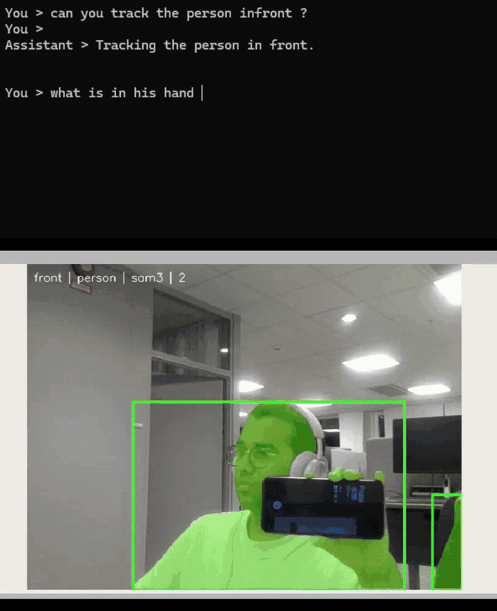
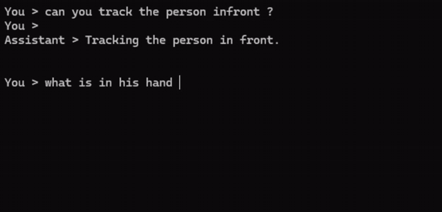

# Recorded ScenePilot demos

The author confirmed that these recordings were captured using the ROS 2 Jazzy container setup. The publication clips retain the original playback timing and show the existing VLM/segmentation workflow. They are illustrative examples, not a controlled accuracy or latency benchmark.

## Watch the full recordings

| View | Browser player | Contents |
| --- | --- | --- |
| Combined | [Watch on Drive](https://drive.google.com/file/d/17LIqK0gdGzUgEhZyIQOMYNO2C3uXj6Oz/view?usp=sharing) | Terminal requests/replies and RViz2 together |
| Terminal | [Watch on Drive](https://drive.google.com/file/d/1EEfU19_h9T7A9u0hPMNp860B_fS1JWtJ/view?usp=sharing) | Typed queries, VLM answers and target-selection confirmations |
| RViz2 | [Watch on Drive](https://drive.google.com/file/d/1hTBy3ep91yk6JNRLcw2_SAukfDpb3UrY/view?usp=sharing) | Camera image, masks and bounding boxes |

These are the author's original approximately 4-minute-45-second recordings. Link-viewer access was checked on 26 October 2026.

## Inline terminal preview

The 20-second previews show actual terminal questions/replies and the synchronized RViz2 result at original speed. One cut joins source windows 94–102 s and 116–128 s. The [preview manifest](preview-manifest.json) records crops, timing and checksums.

## Download edited MP4 excerpts

| File | Duration | Contents |
| --- | --- | --- |
| [Combined MP4](https://github.com/ADHU-ADHU/scenepilot-ros2/raw/refs/heads/main/docs/demos/visual-question-answering.mp4) | 68 s | Smartphone question/answer, followed by phone selection and segmentation |
| [Terminal MP4](https://github.com/ADHU-ADHU/scenepilot-ros2/raw/refs/heads/main/docs/demos/terminal-interaction.mp4) | 68 s | Terminal-only questions, answers and target-selection confirmations |
| [RViz2 MP4](https://github.com/ADHU-ADHU/scenepilot-ros2/raw/refs/heads/main/docs/demos/tracking-highlights.mp4) | 80 s | Four 20-second excerpts: person, phone, headphones, glasses |

These links point directly to raw MP4 downloads. GitHub's repository file viewer can show a size warning for the same files; use the Drive players above for browser viewing.

Additional tracking examples

The clips use H.264, 15 FPS and MP4 fast-start metadata. Silent audio tracks were removed. The question-answering view is cropped to focus on the interaction and camera output; the unused terminal area is masked. All original recordings remain unchanged outside the repository. The terminal banner and ROS package names in the current source were renamed for the public ScenePilot presentation.

The [media manifest](media-manifest.json) records source hashes, selected time windows, encoding details and publication-file checksums. Model outputs in a single recording should not be treated as general accuracy guarantees.
