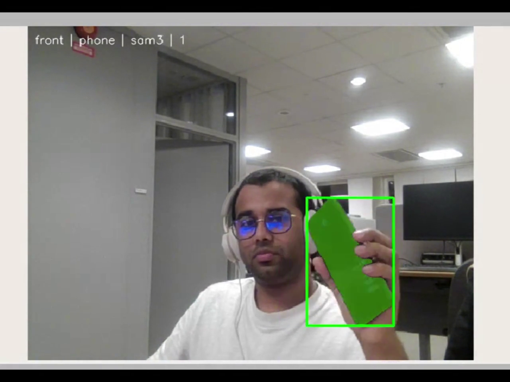

# Recorded ScenePilot demos

The author confirmed that these recordings were captured using the ROS 2 Jazzy container setup. The publication clips retain the original playback timing and show the existing VLM/segmentation workflow. They are illustrative examples, not a controlled accuracy or latency benchmark.

| File | Duration | Contents |
| --- | --- | --- |
| [tracking-highlights.mp4](tracking-highlights.mp4) | 80 s | Four 20-second excerpts: person, phone, headphones, glasses |
| [terminal-interaction.mp4](terminal-interaction.mp4) | 68 s | Terminal-only view: smartphone question/answer and target-selection confirmations |
| [visual-question-answering.mp4](visual-question-answering.mp4) | 68 s | Smartphone question/answer, followed by phone selection and segmentation |
| [tracking-preview.gif](../assets/tracking-preview.gif) | 12 s loop | Short visual preview of the four target categories |

If GitHub does not play a file inline, use its **Raw** or **Download raw file** control to open the MP4 in a video player.

The clips use H.264, 15 FPS and MP4 fast-start metadata. Silent audio tracks were removed. The question-answering view is cropped to focus on the interaction and camera output; the unused terminal area is masked. All original recordings remain unchanged outside the repository. The terminal banner and ROS package names in the current source were renamed for the public ScenePilot presentation.

The [media manifest](media-manifest.json) records source hashes, selected time windows, encoding details and publication-file checksums. Model outputs in a single recording should not be treated as general accuracy guarantees.
